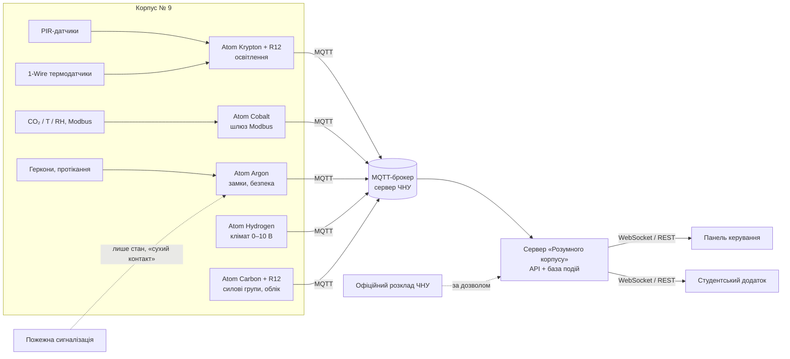

# Архітектура системи «Розумний корпус»

## Цільова схема (після погодження з університетом)



Пожежна сигналізація та евакуаційні системи лишаються автономними. Система може лише **читати**
їхній узагальнений стан (наприклад, через сухий контакт «Пожежа / Несправність») і за погодженням
із фахівцями.

## Прототип (поточна реалізація)

```mermaid
flowchart LR
  BLD[data/building.js] --> SCH[core/schedule.js]
  SD[data/schedule-data.js] --> SCH
  SCH --> SEN[core/sensors.js<br>СИМУЛЯТОР]
  SEN --> I3[core/i3-adapter.js<br>sim | mqtt]
  I3 --> EN[core/energy.js]
  I3 --> UI
  SEC[core/security.js] --> UI
  EN --> UI[ui/dashboard.js · student/app.js]
  ST[(core/store.js<br>localStorage)] <--> UI
  UI --> V[viewer/viewer3d.js]
```

- **Без збирача:** звичайні `<script>`, глобальний простір імен `SK`. Відкривається з диска (file://).
- **Детермінована симуляція:** показники датчиків обчислюються як функція від часу, розкладу й режиму.
  Тому всі вкладки бачать однакові значення, а історію енергії можна відновити за будь-який момент.
- **Модульність (ТЗ п. 4):** `core/` не залежить від інтерфейсу. Щоб підключити реальні дані,
  замінюють джерело даних, а модулі інтерфейсу лишаються без змін.

## Як перейти від демо до реальних даних

| Що | Де | Як замінити |
|---|---|---|
| Приміщення | `js/data/building.js` | Масив `rooms`: `{id, block, floor, type, x0, x1, y0, y1}` за офіційними планами (метри, вісь y — на північ) |
| Розклад | `SK.schedule.baseLessons()` | Завантажувати з API: `{id, room, day 1..5, pair 1..6, group, teacher, subject, kind}` |
| Датчики | `SK.i3.connect(url)` | Підключити `mqtt.js` (браузерна збірка) і вказати брокер з підтримкою WebSocket |
| Стан, бронювання, події | `js/core/store.js` | Замінити `localStorage` на REST/WebSocket-сервер з автентифікацією |
| Ролі | `SK.security.ROLES` | Видавати роль після входу через університетський обліковий запис |

### Запропонована схема MQTT-топіків

```
chnu/k9/{блок}/{поверх}/{кімната}/{датчик}   → {"ts":…, "value":742, "unit":"ppm", "device":"CO2-А-305"}
chnu/k9/{блок}/{поверх}/{кімната}/mode/set   ← {"mode":"presentation"}
chnu/k9/events                               → {"type":"door_forced", "room":"А-305", …}
```

Це **наша** пропозиція. Формат, який фактично публікують контролери Atom, потрібно погодити з i3 Engineering.
Якщо він інший, перетворення робимо на сервері або в `i3-adapter.js`.

## Безпека прототипу

- Ролі в прототипі перемикаються без пароля, щоб демонструвати різні можливості. У робочій версії роль видає сервер.
- Прототип нічим не керує фізично: усі «відчинити двері» та сценарії — симуляція.
- Персональні дані не зберігаються. Бронювання підписуються як «Студент КН-21».
